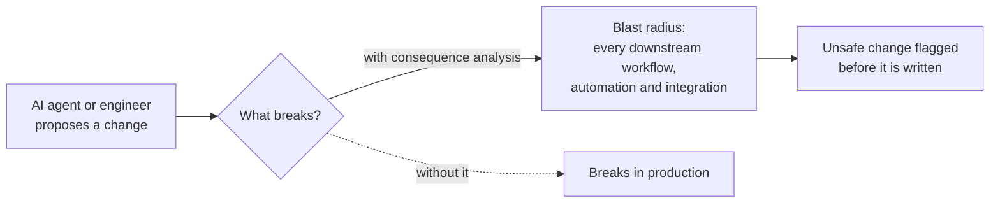

<a href="https://yesprasad.com">
  <picture>
    <source media="(prefers-color-scheme: dark)" srcset="assets/banner-dark.svg">
    <source media="(prefers-color-scheme: light)" srcset="assets/banner-light.svg">
    
  </picture>
</a>

<div align="center">

[](https://yesprasad.com)
[](https://www.linkedin.com/in/eshwarprasadyaddanapudi)
[](https://x.com/yesprasad26)
[](https://medium.com/@y.eshwarprasad)
[](https://www.youtube.com/@NodejsEveryday)

**Making the consequences of change visible before it ships, for engineers and AI agents.**

<sub>Previously Engineering Manager, ServiceNow&nbsp; · &nbsp;Published research&nbsp; · &nbsp;Patent pending&nbsp; · &nbsp;Conference speaker&nbsp; · &nbsp;Hackathon judge&nbsp; · &nbsp;Writing in public since 2005</sub>

</div>

<br>

I build the infrastructure layer beneath AI coding agents — the part that gives them architectural awareness, dependency intelligence, and runtime guardrails so they can operate safely in complex enterprise systems.

## The problem I'm solving

<div align="center">


</div>

Today's AI coding tools are powerful but architecturally blind. They generate code without understanding what breaks downstream. In enterprise systems — where workflows, automations, approvals, and integrations are deeply interconnected — a single unsafe change can cascade across production.



I'm building open-source infrastructure that closes this gap: giving AI agents real project context, blast radius awareness, and consequence analysis before they write a single line of code.

## What I've shipped

<table>
<tr>
<td width="50%" valign="top">

### 🔥 fluent-graph
<sub>OPEN SOURCE · SERVICENOW · FLAGSHIP</sub>

Graph engine and CLI that maps dependency lineage and **blast radius** inside large ServiceNow codebases — a "before you deploy" safety check that didn't exist before.

```bash
npx @yesprasad/fluent-graph review
```

[](https://www.npmjs.com/package/@yesprasad/fluent-graph)
[](https://www.npmjs.com/package/@yesprasad/fluent-graph)

</td>
<td width="50%" valign="top">

### 🤖 fluent-graph-mcp
<sub>MCP SERVER · CLAUDE · CURSOR</sub>

Connects AI coding agents to fluent-graph. One configuration, and the agent **reasons over real graph data** instead of hallucinating assumptions about system structure.

```bash
npx @yesprasad/fluent-graph-mcp
```

[](https://www.npmjs.com/package/@yesprasad/fluent-graph-mcp)
[](https://www.npmjs.com/package/@yesprasad/fluent-graph-mcp)

</td>
</tr>
<tr>
<td width="50%" valign="top">

### 🧭 deep-graph
<sub>OPEN SOURCE · AI CODE REVIEW</sub>

Structural context for AI code review. Answers one question for TypeScript and Java codebases: **what breaks if this file changes?**

```bash
npx @yesprasad/deep-graph blast src/types/graph.ts
```

[](https://www.npmjs.com/package/@yesprasad/deep-graph)
[](https://www.npmjs.com/package/@yesprasad/deep-graph)

</td>
<td width="50%" valign="top">

### 🏥 benefits-explainer
<sub>PRODUCTION RAG · AWS CDK</sub>

Health insurance benefits Q&A where answers are **grounded only in the plan documents**, PII is masked before the model sees it, and off-topic questions never reach the LLM.

<sub>AWS CDK · S3 Vectors · Titan Embed V2 · Nova Micro · Bedrock Guardrails</sub>

[](https://github.com/yesprasad/AWS-Bedrock-CDK-Benefits-QnA)

</td>
</tr>
</table>

<details>
<summary><b>fluent-graph</b> — what it does in practice</summary>
<br>

Enterprise platforms like ServiceNow are notoriously opaque — thousands of interconnected scripts, workflows, and business rules with no clear visibility into what depends on what. fluent-graph turns that into a queryable directed graph.

- Parses and maps dependency chains across entire ServiceNow instances
- Calculates blast radius for any proposed change — showing every downstream workflow, automation, and integration that could break
- Exposes hidden dependencies that aren't documented anywhere
- Gives engineering teams a "before you deploy" safety check that didn't exist before

**Built with:** Node.js, TypeScript, directed graph modeling, CLI architecture

</details>

<details>
<summary><b>fluent-graph-mcp</b> — what changes for the AI agent</summary>
<br>

This is the bridge between AI coding tools and real system architecture. One configuration connects an agent to the full dependency graph of a project.

- Before modifying a script, the agent queries blast radius and sees every downstream dependency that could break
- Instead of hallucinating assumptions about system structure, the agent reasons over real graph data
- Unsafe modifications get flagged before they're generated, not after they hit production

**Why this matters:** Most AI coding failures in enterprise aren't syntax errors — they're context failures. The agent didn't know that changing one business rule would break an approval chain three layers deep. fluent-graph-mcp solves that at the infrastructure level.

**Built with:** Node.js, TypeScript, Model Context Protocol (MCP), graph query interface

</details>

<details>
<summary><b>deep-graph</b> — why it exists</summary>
<br>

AI code review tools read diffs. They don't know what depends on what you changed. deep-graph builds a dependency graph from the strongest semantic information available in the repository and traces a pull request's blast radius, with no string matching.

**Handles:** path aliases, barrel re-exports, cross-package imports, TypeScript and Java

</details>

<details>
<summary><b>benefits-explainer</b> — what it enforces and what I learned</summary>
<br>

Employees ask natural-language questions about their benefits plans and get grounded, policy-specific answers. No general knowledge, no hallucinated coverage details — the LLM reasons only over retrieved chunks from the actual plan documents.

**What it enforces:**

- Answers grounded exclusively in uploaded policy text — the LLM never generates from general knowledge
- PII automatically masked before any question reaches the model (names, SSNs, phone numbers, addresses)
- Off-topic queries blocked at the guardrail layer before they touch the LLM
- Per-plan filtering — a PPO employee only gets PPO answers, no cross-plan bleed

**What I learned building it:**

- Traced one sentence through two completely different vector pipelines (ChromaDB locally vs S3 Vectors on AWS) — [wrote about the internals](https://yesprasad.com/writing/from-chromadb-to-s3-vectors-what-i-learned-about-how-embeddings-actually-work/)
- Discovered why metadata filtering is non-optional in multi-document RAG — without it, similarity search returns chunks from the wrong plan
- Built the agent layer (perceive → reason → act) when single-retrieval RAG couldn't handle multi-part benefits comparisons — [wrote about that transition](https://yesprasad.com/writing/from-rag-to-agentic-rag-why-i-built-it-whether-it-s-real-and-what-comes-next/)

</details>

## If this is your problem, I've already built for it

| You need… | What I've built | See it |
| :-- | :-- | :-- |
| AI coding agents that know what they're about to break | An MCP server that hands agents the real dependency graph before they write code | [fluent-graph-mcp](https://www.npmjs.com/package/@yesprasad/fluent-graph-mcp) |
| A safety check before changes ship in ServiceNow | Blast radius and consequence analysis for every change, ready as a CI gate | [fluent-graph](https://yesprasad.com/platforms/) |
| Code review that sees beyond the diff | Pull-request blast radius for TypeScript and Java | [deep-graph](https://www.npmjs.com/package/@yesprasad/deep-graph) |
| RAG that stays grounded and safe in regulated domains | Production RAG on AWS with guardrails, PII masking and per-plan filtering | [benefits-explainer](https://github.com/yesprasad/AWS-Bedrock-CDK-Benefits-QnA) |
| Agent workflows that fail loudly, not silently | Tests that catch the LangGraph steps that never run | [The Node That Never Ran](https://yesprasad.com/writing/the-node-that-never-ran-what-langgraph-does-not-check-at-compile-time/) |

## Writing

I write about what I learn while building — RAG internals, vector search, agentic systems, and infrastructure decisions. Every failure written down.

| | |
| :-- | :-- |
| **[The Node That Never Ran: What LangGraph Does Not Check at Compile Time](https://yesprasad.com/writing/the-node-that-never-ran-what-langgraph-does-not-check-at-compile-time/)**<br><sub>One missing edge. The graph compiled, ran and returned success — and never created the invoice.</sub> | <sub>Aug 2026</sub> |
| **[Building AI Systems We Can Trust: Lessons from a Credential Security Incident](https://yesprasad.com/writing/building-ai-systems-we-can-trust-lessons-from-a-credential-security-incident/)**<br><sub>If we act only after a possible exposure, what have we protected, and what remains unresolved?</sub> | <sub>Oct 2026</sub> |
| **[From ChromaDB to S3 Vectors — What I Learned About How Embeddings Actually Work](https://yesprasad.com/writing/from-chromadb-to-s3-vectors-what-i-learned-about-how-embeddings-actually-work/)**<br><sub>One sentence traced through two completely different vector pipelines.</sub> | <sub>Jan 2026</sub> |
| **[From RAG to Agentic RAG — Why I Built It, Whether It's Real, and What Comes Next](https://yesprasad.com/writing/from-rag-to-agentic-rag-why-i-built-it-whether-it-s-real-and-what-comes-next/)**<br><sub>When RAG actually needs an agent layer, and the perceive → reason → act loop.</sub> | <sub>Sep 2025</sub> |

📚 **Series: [RAG from Scratch](https://yesprasad.com/series/rag-from-scratch/)** — built on an 8GB laptop, no GPU, no LangChain, and taken all the way to agents and AWS.

→ **[All writing at yesprasad.com/writing](https://yesprasad.com/writing/)**

## Research, talks & recognition

- 📄 **[The Authorship Inversion](https://doi.org/10.5281/zenodo.20513392)** — why autonomous agent architecture demands a pre-action consequence substrate. Zenodo, 2026.
- 🎤 **AI Can Write Code. It Can't See the System.** — Applied AI Conference 2026, lightning talk
- 🎤 **Your Coding Agent Changed an ACL in 26 Seconds. What Are the Consequences?** — nullEDGE '26
- ⚖️ **Hackathon judge**
- 🏆 **Winner, Telstra Innovation Hackathon** — #TIH2019, 69 teams, 4 countries
- ◆ **Provisional patent filed** — patent pending, 2026

<sub>[Research](https://yesprasad.com/research/) · [Talks](https://yesprasad.com/talks/) · [Industry leadership](https://yesprasad.com/leadership/)</sub>

## What I think about

I'm less interested in what model you use and more interested in the infrastructure around it:

- **Dependency intelligence** — Can an AI agent understand what depends on what before it acts?
- **Runtime consequence analysis** — Can we calculate blast radius in real time, before deployment?
- **Execution safety** — What guardrails make autonomous engineering systems trustworthy enough for production?
- **Context engineering** — How do we feed AI agents the right project context at the right time?
- **Graph-aware reasoning** — How do directed graphs change the way AI agents plan and execute?

The long-term vision: foundational infrastructure for autonomous engineering systems that are safe enough to trust with real production systems.

## Let's talk

If you're building in the AI infrastructure, agentic systems, or developer tooling space — I'd like to hear what you're working on.

<div align="center">

[](https://yesprasad.com)
[](https://www.linkedin.com/in/eshwarprasadyaddanapudi)
[](https://x.com/yesprasad26)

</div>
